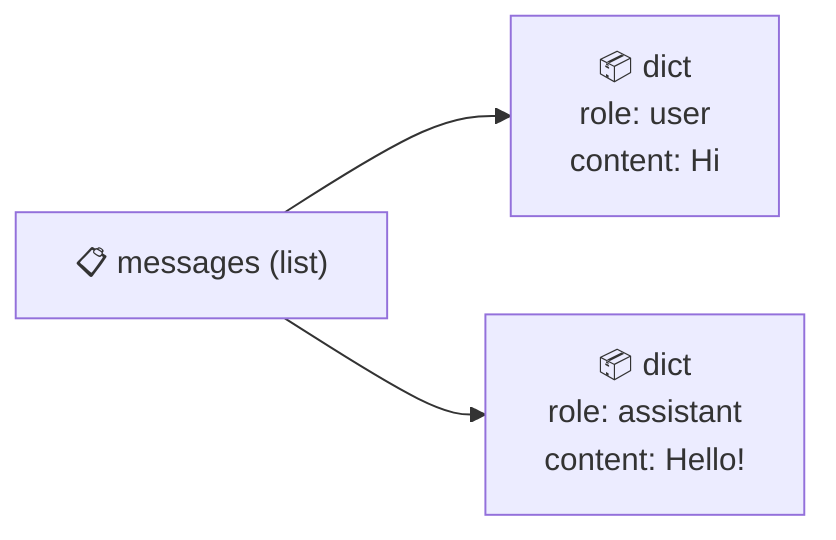

# 00 - Python Basics

Only what we need for the AI code. Try each example in the terminal: type `python3`, paste, press Enter. Type `exit()` to leave.

## 1. Print
```python
print("Hello")            # shows text on screen
```

## 2. Variables (a box with a name)
```python
name = "Aditya"           # text  -> called a "string"
age = 22                  # number -> called an "int"
is_learning = True        # True / False -> called a "bool"
print(name, age)
```

## 3. Input (ask the user)
```python
city = input("Your city: ")   # waits for you to type
print("You live in", city)
```

## 4. If / else (make a decision)
```python
if age >= 18:
    print("Adult")
else:
    print("Minor")
```
⚠️ The **spaces at the start of a line** (indentation) matter in Python. They show which lines belong to the `if`.

> 💬 **Hinglish:** Line ke aage jo space hai, wahi batata hai ki ye line `if` ke andar hai. Space galat hua to error aayega.

## 5. List (many items, in order)
```python
fruits = ["apple", "mango"]
fruits.append("banana")       # add item
print(fruits[0])              # first item -> apple (counting starts at 0)
```
> 💬 **Hinglish:** Python mein ginti 0 se shuru hoti hai, 1 se nahi. Pehla item `[0]`, doosra `[1]`.

## 6. Dictionary (key → value)
```python
person = {"name": "Aditya", "age": 22}
print(person["name"])         # -> Aditya
```
> 💬 **Hinglish:** Dictionary ek dabba hai jisme har cheez ka ek naam (key) hai. Naam bolo, value mil jaayegi.
💡 Our AI messages are **a list of dictionaries**:
```python
messages = [{"role": "user", "content": "Hi"}]
```


## 7. Loops (repeat)
```python
for fruit in fruits:          # once for each item
    print(fruit)

while True:                   # forever...
    text = input("> ")
    if text == "exit":
        break                 # ...until break
```
> 💬 **Hinglish:** `for` = list ke har item ke liye ek baar chalo. `while True` = hamesha chalte raho, jab tak `break` na aaye.

## 8. Functions (reusable block of code)
```python
def greet(name):
    return "Hello " + name

print(greet("Aditya"))
```
> 💬 **Hinglish:** Function ek machine hai. Andar kuch daalo (`name`), wo kaam karke result `return` kar deti hai.

## 9. Import (use code someone else wrote)
```python
import os                     # built into Python
from openai import OpenAI     # installed with pip
```

## 10. Dot `.` (get something inside)
```python
response.choices[0].message.content
# response -> choices list -> first item -> message -> content (the text)
```
> 💬 **Hinglish:** Dot `.` matlab "iske andar jao". Jaise dabba ke andar dabba, aur sabse andar wale mein AI ka jawab hai.
