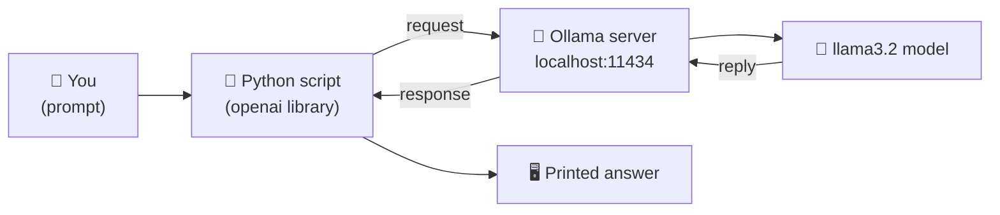
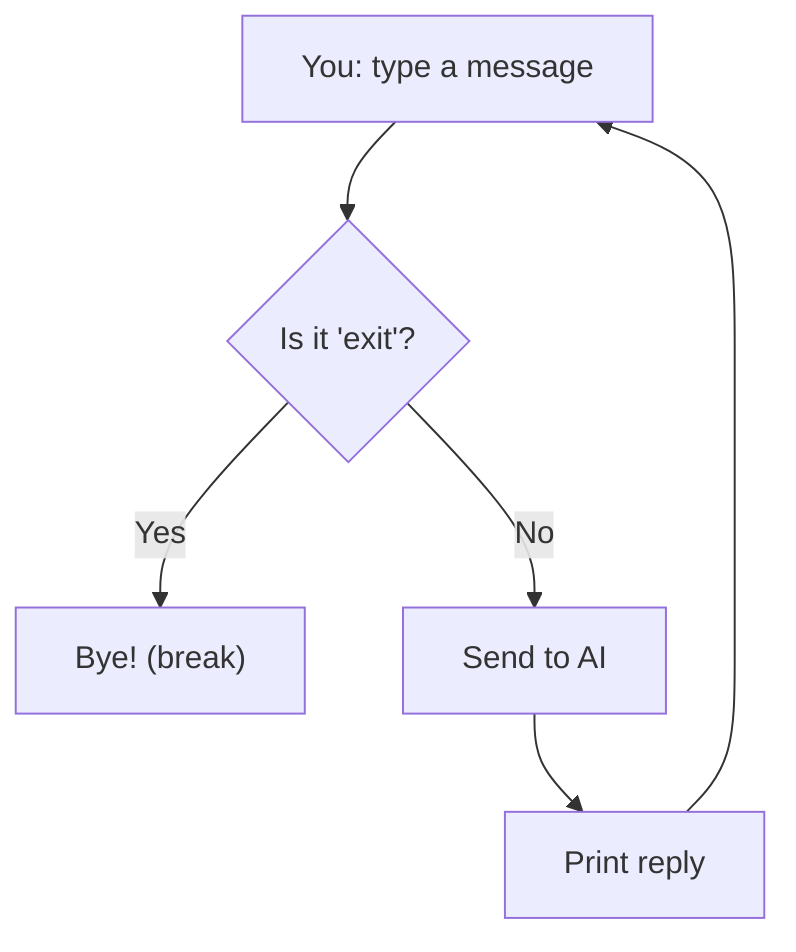

# 01 - Chat with Local AI (Ollama)



## Setup (once)
```bash
brew install python3                 # check: python3 --version (not --v)
python3 -m venv .venv                # private folder for packages
source .venv/bin/activate            # turn on (every new terminal)
pip install -r requirements.txt

curl -fsSL https://ollama.com/install.sh | sh   # asks Mac login password (typing is invisible)
open -a Ollama                                  # starts server in background
ollama pull llama3.2:3b                         # download model (~2 GB)
```

| Error | Meaning |
|---|---|
| `Unknown option: --v` | Use `--version` |
| `address already in use` on `ollama serve` | Server already running ✅ |
| `No module named 'openai'` | Turn on venv, then `pip install -r requirements.txt` |

---

## Step 1: First AI call → [step1_simple_ai.py](step1_simple_ai.py)
Send one fixed prompt, print the reply.
1. Import `OpenAI` (Ollama understands the same format)
2. Create `client` pointing to local Ollama (API key can be any text)
3. `client.chat.completions.create(model=..., messages=[...])`
4. Print `response.choices[0].message.content`

**messages** = list of `{"role": "user", "content": "your text"}`

## Step 2: User input → [step2_ask_ai.py](step2_ask_ai.py)
Type your own question:
```python
user_prompt = input("You: ")
```
Limitation: answers one question, then stops.

## Step 3: Chat loop + .env → [step3_chat_loop.py](step3_chat_loop.py)
**Loop**: keep asking until you type `exit`

```python
while True:
    user_prompt = input("You: ")
    if user_prompt.lower() == "exit":
        break
```
**.env**: keep settings outside the code
```python
load_dotenv()                  # read .env
os.getenv("MODEL_NAME")        # get one value
```
- `.env` = real values, **never upload** (in `.gitignore`)
- `.env.example` = safe sample → `cp .env.example .env`

**Problem 🤔** AI has no memory:
```
You: My name is Aditya
You: What is my name?   → doesn't know!
```
→ Fixed in Step 4.

---

## Run
```bash
python 01_chat_with_local_ai/step3_chat_loop.py
```
