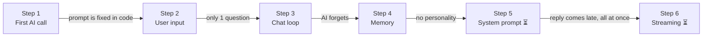
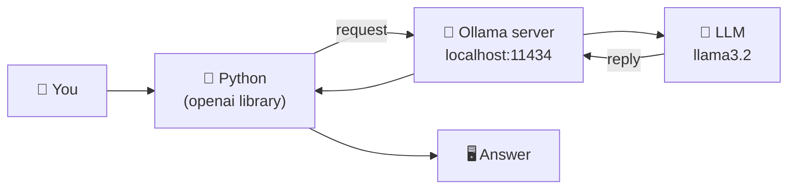
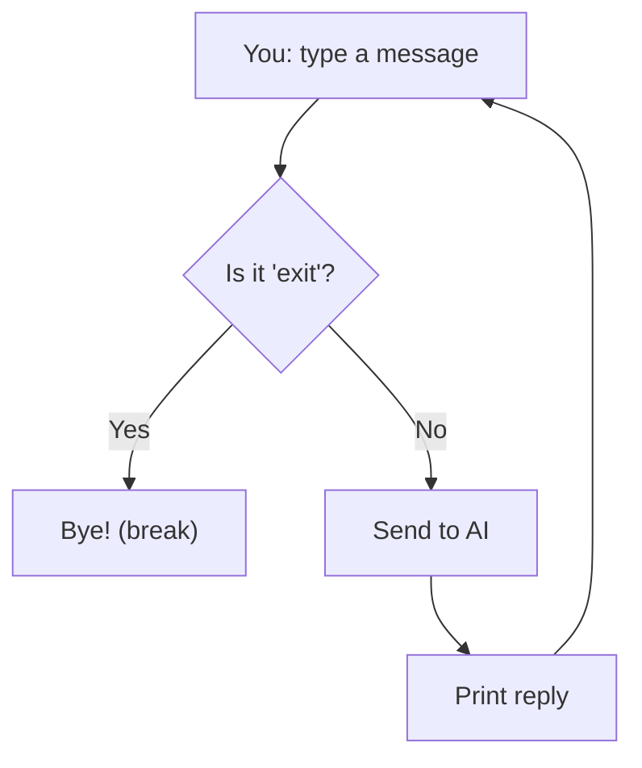
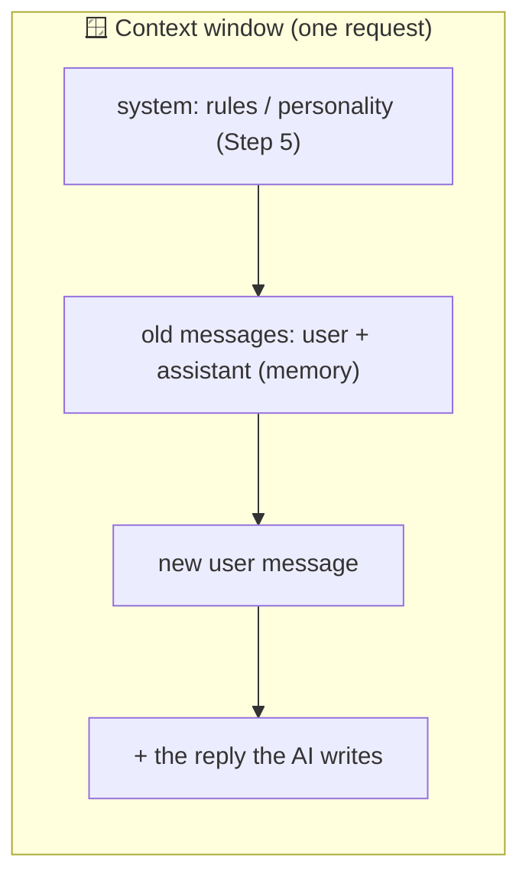
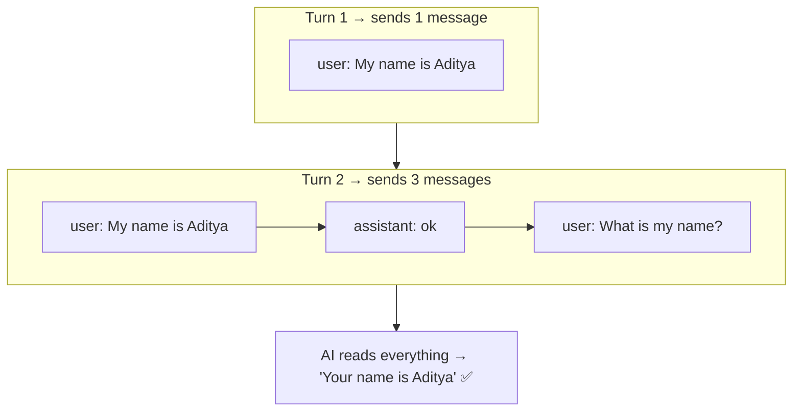

# 01 - Chat with Local AI (Ollama)

**Goal of this chapter:** build a small chatbot, one step at a time. Each step fixes the problem left by the step before it.



## Setup (once)
```bash
brew install python3                 # check: python3 --version (not --v)
python3 -m venv .venv                # private folder for packages
source .venv/bin/activate            # turn on (every new terminal)
pip install -r requirements.txt

curl -fsSL https://ollama.com/install.sh | sh   # asks Mac login password (typing is invisible)
open -a Ollama                                  # starts server in background
ollama pull llama3.2:3b                         # download model (~2 GB)
```

| Error | Meaning |
|---|---|
| `Unknown option: --v` | Use `--version` |
| `address already in use` on `ollama serve` | Server already running ✅ |
| `No module named 'openai'` | Turn on venv, then `pip install -r requirements.txt` |

---

## Step 1: First AI call → [step1_simple_ai.py](step1_simple_ai.py)

### Concept: what is an LLM?
**LLM (Large Language Model)** = a model trained on a huge amount of text. You give it text, and it predicts the best text to come next. That predicted text is the "answer". `llama3.2:3b` is a small LLM (3b = 3 billion parameters).


> 💬 **Hinglish:** Ollama laptop pe chalne wala server hai jo LLM ko chalata hai. Python usse request bhejta hai, Ollama model se jawab nikal ke wapas deta hai. Sab laptop pe hota hai, internet nahi chahiye.

### Concept: messages, role and content
We don't send plain text. We send a **list of messages**. Each message has two parts:
- **`role`**: who is speaking
- **`content`**: what they said (the actual text)

| role | who | when we use it |
|---|---|---|
| `user` | you | Step 1 onwards |
| `assistant` | the AI | Step 4 (memory) |
| `system` | rules / personality for the AI | Step 5 |

```python
messages=[{"role": "user", "content": "Explain what AI is in one sentence."}]
```

### Code steps
1. Import `OpenAI`. Ollama understands the same format as OpenAI, so the same library works.
2. Create a `client` with `base_url` = where to send the request (local Ollama). The API key can be any text.
3. `client.chat.completions.create(model=..., messages=[...])` sends the request.
4. `response.choices[0].message.content` is the reply text. `choices` is a list because an API can return several answers; we take the first one.

**Problem 🤔** The prompt is written inside the code. To ask something new, you have to edit the file. → Step 2

---

## Step 2: User input → [step2_ask_ai.py](step2_ask_ai.py)
🔗 **Fixes Step 1:** you type the question while the program runs.
```python
user_prompt = input("You: ")                   # wait for typing
{"role": "user", "content": user_prompt}       # same message shape as Step 1, only content changes
```

**Problem 🤔** It answers one question, then the program ends. → Step 3

---

## Step 3: Chat loop + .env → [step3_chat_loop.py](step3_chat_loop.py)
🔗 **Fixes Step 2:** keep asking questions until you type `exit`.


```python
while True:
    user_prompt = input("You: ")
    if user_prompt.lower() == "exit":
        break
```

**Bonus: .env** keeps settings outside the code.
```python
load_dotenv()                  # read .env
os.getenv("MODEL_NAME")        # get one value
```
- `.env` = real values, **never upload** (it's in `.gitignore`)
- `.env.example` = safe sample → `cp .env.example .env`

> 💬 **Hinglish:** `.env` ek settings ki diary hai. URL ya key code mein likhne ki jagah yahan likhte hain, taaki secret cheezein GitHub pe na jaayein.

**Problem 🤔** The AI forgets everything:
```
You: My name is Aditya
You: What is my name?   → doesn't know!
```
Why? Each loop sends **only the new message**. → Step 4

---

## Step 4: Memory → [step4_memory.py](step4_memory.py)
🔗 **Fixes Step 3:** the AI remembers the conversation.

### Concept: an LLM is stateless
**Stateless** = the LLM stores nothing between requests. Every request is brand new to it, as if it has never talked to you before. So the memory has to come from **us**.

> 💬 **Hinglish:** LLM ke paas apni koi memory ya storage nahi hoti. Har request uske liye pehli mulaqat jaisi hai. Isliye yaad rakhne ka kaam humein karna padta hai.

### Concept: context window
**Context window** = everything the LLM can "see" in one request. It only reads what is inside this window, nothing else.

What goes inside:

- Its size is **limited**. Size is measured in **tokens** (small pieces of text; 1 token ≈ ¾ of an English word).
- When the window is full, the oldest messages get cut and the AI "forgets" them.
- More text in the window = slower replies.

> 💬 **Hinglish:** Context window ek whiteboard jaisa hai. AI sirf wahi padh sakta hai jo board pe likha hai. Board ka size fixed hai, bhar gaya to purani baatein mitt jaati hain.

### How we use it
Our `messages` list **is** what we put into the context window. We save every message and send the whole list each time.
```python
messages = []                                                  # empty at start
messages.append({"role": "user", "content": user_prompt})      # save my message
response = client.chat.completions.create(model=model, messages=messages)  # send ALL
messages.append({"role": "assistant", "content": reply})       # save AI reply
```

How `messages` grows:


⚠️ The list lives in your program's RAM, so restarting the script clears the memory.

**Problem 🤔** The AI has no fixed role or personality. It can't be told to "always act like a Python teacher". → Step 5 adds a `system` message at the top of the context window.

---

## Run
```bash
python 01_chat_with_local_ai/step4_memory.py
```
