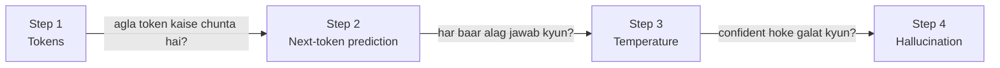
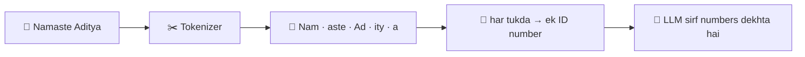
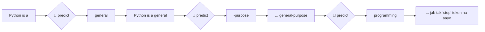
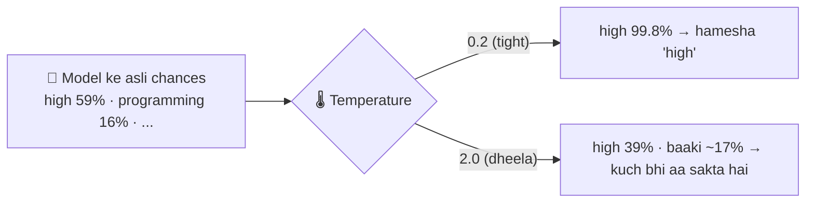
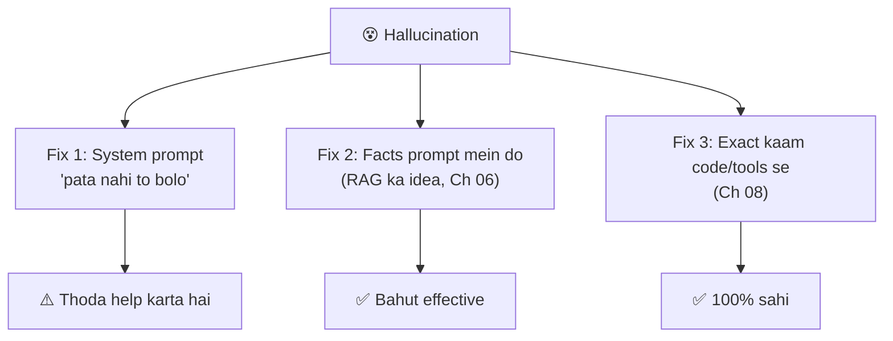
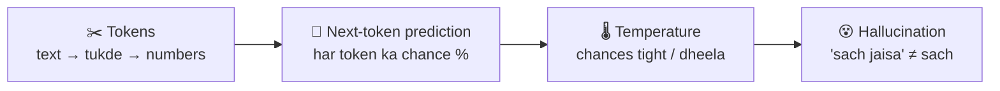

# 02 - How LLMs Work ✅

🔗 **Pichle chapters se connection:** Chapter 01 mein LLM use kiya, aur streaming mein ajeeb tukde dekhe ("Nam" + "aste"). Chapter 08 mein LLM ne maths mein galti ki. Is chapter mein dekhenge ki **LLM ke andar asal mein kya hota hai**, aur ye sab kyun hua.



---

## Step 1: Tokens → [step1_tokens.py](step1_tokens.py)

### 🧠 Concept: token kya hai?
LLM **words nahi padhta**, woh **tokens** padhta hai. Token = text ka chhota tukda: poora word, aadha word, ek space ke saath word, ya sirf `,`.

**Tokenizer** = woh program jo text ko tokens mein todta hai. Har token ka ek **number (ID)** hota hai, aur LLM asal mein sirf in numbers ko dekhta hai.



> 💬 **Hinglish:** Tokens = **Lego blocks** 🧱. LLM ke paas lagbhag 1.28 lakh alag-alag blocks hain (Llama 3 ka vocabulary). Har sentence inhi blocks ko jod ke banta hai. Common words ("Python", " the") ek block hain. Rare words ("Aditya") 2-3 blocks mein toot jaate hain.

### 🔍 Part A: tokens dekhna
Streaming mein har chunk **ek token** hota hai (01 Step 6). Beech mein ` | ` lagake print kiya:
```
Python |  is |  a |  high | -level | , |  interpreted |  programming |  language | ...
```
Dhyan do:
- `" is"` mein **space bhi token ka hissa hai**
- `"high"` + `"-level"` = 2 tokens
- `,` aur `.` bhi alag tokens hain

### 🔢 Part B: tokens ginna
| Text | Tokens |
|---|---|
| `Hello, how are you?` (English) | **6** |
| `Namaste, aap kaise ho?` (Hinglish) | **9** |
| `नमस्ते, आप कैसे हैं?` (Hindi) | **12** 😮 |
| `48271 multiplied by 9183` | **7** |

**Isse 3 badi baatein samajh aati hain:**

**1. Hindi ko 2x tokens lagte hain.** Same baat, English mein 6 tokens, Hindi mein 12. Tokenizer zyada English text pe bana hai, isliye Hindi ke "blocks" chhote hain.
→ Hindi mein AI use karna **mehenga** padta hai aur **context window jaldi bharta hai** (01 Step 4).

**2. Numbers bhi tukdon mein toot-te hain.** Llama ka tokenizer numbers ko max 3 digit ke tukdon mein todta hai: `48271` → `482` + `71`. LLM ko poora number dikhta hi nahi, sirf tukde dikhte hain.
→ Isliye Chapter 08 mein LLM ka multiplication **galat** tha, aur calculator tool zaroori tha.

**3. Hidden tokens (25): har request mein kuch extra jaata hai.** Ollama humare messages ko ek **template** mein lapet ke bhejta hai (`ollama show llama3.2:3b --template` se dekh sakte ho):
```
<|start_header_id|>system<|end_header_id|>
Cutting Knowledge Date: December 2023
<|eot_id|><|start_header_id|>user<|end_header_id|>
Hello, how are you?<|eot_id|>
```
- `system` / `user` / `assistant` roles (01) asal mein aise **special tokens** ban jaate hain
- **`Cutting Knowledge Date: December 2023`**: model ka training data yahin tak ka hai. Isse aage ki duniya ke baare mein use kuch nahi pata. (Isliye current time ke liye tool chahiye tha, 08.)
- Jab tools dete hain, to template model ko bolta hai *"please respond with a JSON for a function call"*. **Isi wajah se** Chapter 08 mein model har sawal pe tool call kar raha tha!

> 💬 **Hinglish:** Tum jo message bhejte ho, woh ek envelope mein jaata hai. Envelope pe kuch extra likha hota hai (roles, date). Woh bhi tokens leta hai, bhale tumhe dikhe nahi.

### 📏 Yaad rakhne ka rule
**1 token ≈ ¾ English word** → 100 tokens ≈ 75 words. Hindi mein isse kaafi zyada tokens lagte hain.

### 📝 Code
```python
response.usage.prompt_tokens     # server batata hai: tumhare message ne kitne tokens liye
max_tokens=1                     # jawab sirf 1 token ka (humein sirf count chahiye)
count_tokens(text) - hidden      # hidden template tokens hata ke asli count
```
`count_tokens()` ek **function** hai (Chapter 00), jise har text ke liye baar-baar use kiya.

### 🌍 Real world
- **API ka bill tokens pe banta hai**: OpenAI, Claude, Gemini sab "per million tokens" ke hisaab se charge karte hain (input aur output alag rate)
- **Context window bhi tokens mein naapa jaata hai**: "128K context" = ek request mein ~1.28 lakh tokens
- **Indian languages ki problem**: isi token issue ki wajah se Indian companies (jaise Sarvam AI) Indic languages ke liye behtar tokenizers wale models bana rahi hain, taaki Hindi sasti aur fast ho

### 🧪 Khud try karo
```bash
python 02_how_llms_work/step1_tokens.py
```
- `texts` list mein apna naam, ek lamba word ("internationalization"), ya emoji 😀 daal ke tokens gino
- Part A ka prompt badal ke dekho, ki kaun se words tootte hain

**Problem 🤔** Theek hai, LLM tokens padhta hai. Par woh **agla token kaise chunta hai?** Kya woh "sochta" hai? → Step 2

---

## Step 2: Next-token prediction → [step2_next_token.py](step2_next_token.py)
🔗 **Step 1 se aage:** LLM tokens padhta hai. Ab dekhte hain ki woh **agla token kaise chunta hai**.

### 🧠 Concept: LLM sirf ek kaam karta hai
**"Ab tak ke tokens dekh ke, agla token kya hoga?"** Bas yahi. Har possible token (1.28 lakh blocks) ke liye woh ek **probability (chance %)** nikaalta hai, phir ek token chun leta hai.

Poora jawab isi ek kaam ko **baar-baar** karke banta hai. Har chuna hua token input mein jud jaata hai, aur phir agla token predict hota hai:

> 💬 **Hinglish:** LLM ek bahut tez **autocomplete** hai. Woh poora jawab pehle se "soch" ke nahi likhta. Ek-ek token likhta hai, aur har token ke baad sochta hai ki "ab aage kya aayega?". Isliye streaming (01 Step 6) mein jawab tukdon mein aata hai.

### 🔍 Part A: ek token ke options
`"The capital of France is"` ke baad:
```
'Paris'       99.91%  ███████████████████
'Par'          0.06%
' Paris'       0.01%
'PAR'          0.00%
'France'       0.00%
```
Model **99.91% sure** hai. Jab fact training data mein bahut baar aaya ho, to probability ek token pe concentrate ho jaati hai.

### 🔍 Part B: poora jawab = bahut saare choices
`"Python is a"` ke baad, har step pe top 3 options:
```
chosen 'general'        | options: 'high' 51%, 'programming' 14%, 'general' 10%
chosen '-purpose'       | options: '-purpose' 99%, ' purpose' 1%, ...
chosen ' programming'   | options: ' programming' 97%, ' language' 2%, ...
chosen ' language'      | options: ' language' 100%, ...
chosen '.'              | options: '.' 98%, ...
```
😮 **Pehle step pe model ne `'general'` (sirf 10%) chuna, jabki `'high'` 51% tha!**
- Model hamesha top wala token nahi chunta. Woh probability ke hisaab se **random draw** karta hai: 51% wala zyada baar aayega, par 10% wala bhi kabhi-kabhi aa jaata hai.
- Ek baar `'general'` chun liya, to aage ke tokens 97-100% sure ho gaye (`-purpose` → `programming` → `language`). Shuru ka ek choice poore jawab ki direction badal deta hai.
- Isi wajah se **same sawal pe har baar alag jawab** aata hai. Ye control kaise karte hain → Step 3 (Temperature)

### 🏋️ Ye probabilities aati kahan se hain? Training
| | **Training** (seekhna) | **Inference** (use karna) |
|---|---|---|
| Kya hota hai | Model internet ka text padhta hai aur har jagah "agla token" guess karta hai. Galat hua to khud ko thoda sudhaarta hai. Ye arabon baar hota hai. | Seekhe hue model se jawab nikalna. **Hum yahi kar rahe hain** |
| Kitna data | Llama 3: ~15 trillion tokens | Bas tumhara prompt |
| Kharcha | Hazaaron GPUs, mahine, crores ₹ | Tumhara laptop, seconds |
| Kab | Ek baar (Meta ne kiya) | Har request pe |

**Parameters** = model ke andar ke numbers ("knobs" 🎛️), jo training mein set hote hain. Inhi mein model ki saari "knowledge" hai.
- `llama3.2:3b` = **3 billion** knobs (~2 GB)
- Bade models: 70b, 400b+. Zyada parameters = zyada patterns yaad = usually smart, par zyada RAM aur slow

> 💬 **Hinglish:** Training = 12 saal school jaana (mehenga, lamba, ek baar). Inference = exam mein jawab likhna (fast, baar-baar). Parameters = dimaag mein jo yaad hai.

### 👀 Attention: LLM context kaise samajhta hai (simple idea)
Agla token predict karte waqt model **pichle saare tokens ko dekhta hai**, aur decide karta hai ki kaun se tokens **zyada important** hain.

*"Aditya ne Rahul ko phone kiya kyunki **woh** bore ho raha tha"*. Yahan "woh" predict/samajhne ke liye model "Aditya" pe zyada **dhyan (attention)** deta hai.

Is technique ko **Attention** kehte hain, aur jo model ise use karte hain unhe **Transformer** kehte hain. GPT ka "T" = Transformer. (2017 ka paper *"Attention Is All You Need"*.)

### 📝 Code
```python
logprobs=True,      # server, probabilities bhi bhejo
top_logprobs=5,     # top 5 options dikhao

math.exp(logprob) * 100    # logprob → percent
```
- **logprob** = probability ka "log" roop (computer ke liye convenient). `math.exp()` use normal chance bana deta hai. Bas itna yaad rakho: `logprob` 0 ke jitna paas, utna sure (`-0.001` ≈ 99.9%).
- `f"{percent:6.2f}%"` = **f-string**: number ko 2 decimal tak format karke text mein daalna.

### 🌍 Real world
- **Phone keyboard ke next-word suggestions**: same idea, bahut chhota model
- **Gmail Smart Compose, GitHub Copilot**: gray text mein aage ka suggestion = next-token prediction
- **Confidence check**: kuch companies logprobs dekh ke pata lagati hain ki model kitna sure hai. Kam probability = "ye jawab double-check karo"

### 🧪 Khud try karo
```bash
python 02_how_llms_work/step2_next_token.py
```
- 2-3 baar chalao: Part A har baar same (99.91% Paris), par Part B mein chosen tokens badal sakte hain
- Part A ka prompt badlo: `"My favourite colour is"`. Ab probabilities kaafi bikhri hongi (koi ek sahi jawab nahi hai)

**Problem 🤔** Model kabhi top token chunta hai, kabhi 10% wala. Ye **randomness kaun control karta hai?** Kya hum use kam-zyada kar sakte hain? → Step 3

## Step 3: Temperature → [step3_temperature.py](step3_temperature.py)
🔗 **Step 2 ki problem:** model kabhi top token chunta hai, kabhi 10% wala. Ye randomness **temperature** control karta hai.

### 🧠 Concept: temperature kya hai?
**Temperature** = ek setting jo token chunne se pehle **chances ko tight ya dheela** karti hai.

| 🌡️ Temperature | Kya hota hai | Jawab |
|---|---|---|
| **0** (thanda) | Hamesha top wala token | Har baar **same**, safe |
| **~0.7-1** (normal) | Mostly top tokens, thoda variety | Natural, thoda alag |
| **1.5+** (garam) | Chhote chances bhi bade ho jaate hain | Creative, par **bhatak** sakta hai |

> 💬 **Hinglish:** Temperature = **risk lene ki aadat**. Temperature 0 = hamesha wahi dish order karna jo sabse zyada pasand hai. Temperature 2 = menu mein kuch bhi try kar lena, kabhi mazedaar, kabhi ajeeb.

### 🔍 Part A: temperature chances ko kaise badalta hai
`"Python is a"` ke baad pehle token ke chances (top 5 options ke andar):
```
🌡️ 0.2                      🌡️ 1.0                      🌡️ 2.0
'high'        99.8% ████    'high'        59.3% ███     'high'        38.7% ██
'programming'  0.1%         'programming' 15.8% █       'programming' 19.9% █
'general'      0.0%         'general'     11.6% █       'general'     17.1% █
'popular'      0.0%         'popular'     11.0% █       'popular'     16.7% █
'vers'         0.0%         'vers'         2.3%         'vers'         7.7%
```
- **Kam temperature** → winner aur bada (99.8%), baaki zero
- **Zyada temperature** → sab barabar ki taraf, chhote options ko bhi mauka



### 🔍 Part B: asli jawab, 3-3 baar
Prompt: *"Write a one-line slogan for a chai shop."*

**🌡️ 0:** teeno **bilkul same**
```
1. "Warming hearts, one cup at a time."
2. "Warming hearts, one cup at a time."
3. "Warming hearts, one cup at a time."
```
**🌡️ 0.8:** milte-julte, thoda alag
```
1. "Warm hearts, one cup at a time."
2. "Warming hearts and souls, one cup at a time."
3. "Warming Hearts, One Cup at a Time."
```
**🌡️ 1.8:** creative, par instruction se **bhatak gaya** (one-line maanga tha, list de di)
```
1. "Elevate Your Day, one sip at a time with Every Cup & Love at [Name] of Chai."
2. Here's a potential slogan for a chai shop: "Warm Up with the Right Blend!" Alternatively, ...
3. "Steeped in tradition, served with warmth and delight."
```

### ⚠️ Sabse important lesson: same ≠ sahi
Chapter 08 wala maths sawal **temperature 0** pe 3 baar poocha:
```
temp 0: 440,841,693
temp 0: 440,841,693
temp 0: 440,841,693
correct: 443,272,593   ❌
```
Temperature 0 ne jawab ko **consistent** bana diya, par **sahi nahi**. Model ka sabse "pasandeeda" token bhi galat ho sakta hai. Temperature randomness control karta hai, **knowledge nahi**. Sahi jawab ke liye tools (08) ya data (RAG, 06) chahiye.

### 🎯 Kab kaunsa temperature?
| Kaam | Temperature |
|---|---|
| Facts, maths, code, JSON nikalna, tool calling, evals | **0 - 0.2** |
| Normal chat, explanations | **0.5 - 0.8** |
| Brainstorming, stories, slogans, naam sochna | **0.9 - 1.2** |
| 1.5+ | Rarely, jawab bekaabu ho jaata hai |

**`top_p`** (ek aur setting): sirf top tokens mein se chuno jinka total chance p tak ho. `top_p=0.9` = sabse kam chance wale tokens hata do. Usually **temperature ya top_p, ek hi badlo**.

### 📝 Code
```python
response = client.chat.completions.create(
    model=model,
    messages=[...],
    temperature=0.8,   # NEW - 0 = fixed, zyada = random
)
```
Part A mein temperature ka formula khud lagaya: `chance = exp(logprob / temperature)`. Temperature se **divide** karte hain, isliye chhota temperature farak ko bada kar deta hai aur bada temperature use chhota.

Naya Python:
- `[math.exp(...) for c in candidates]` = **list comprehension**: ek line mein `for` loop chala ke nayi list banana
- `for c, w in zip(candidates, weights)` = do lists ko saath-saath chalana (pehla-pehla, doosra-doosra...)
- `for attempt in range(3)` = loop 3 baar chalao (0, 1, 2)

### 🌍 Real world
- **Customer support, data extraction, coding tools** temperature kam rakhte hain, kyunki har baar same aur predictable jawab chahiye
- **Creative tools** (story/slogan/marketing copy generators) zyada rakhte hain
- **ChatGPT ka "Regenerate" button**: temperature > 0 hai, isliye har baar naya jawab aata hai
- **Evals (Chapter 13)** mein temperature 0 rakhte hain, taaki test results repeat ho sakein

### 🧪 Khud try karo
```bash
python 02_how_llms_work/step3_temperature.py
```
- Part B ka prompt badlo: `"Suggest a name for my cat."` 0 vs 1.2 pe
- Chapter 01 ke chatbot (`step6_streaming.py`) mein `temperature=0` add karo, aur ek hi sawal 2 baar poocho

**Problem 🤔** Temperature 0 pe bhi model confidently **galat** bola (440,841,693). Model ko pata hi nahi chalta ki woh galat hai. Ye kyun hota hai, aur kaise bachein? → Step 4 (Hallucination)

## Step 4: Hallucination → [step4_hallucination.py](step4_hallucination.py)
🔗 **Step 3 ki problem:** temperature 0 pe bhi model confidently **galat** bola, aur use pata bhi nahi chala.

### 🧠 Concept: hallucination kya hai?
**Hallucination** = LLM ka **confident hoke galat ya banaya hua** jawab dena: fake facts, fake naam, fake links, galat maths.

**Kyun hota hai?** Ab tak ka sab kuch jodo:
1. **LLM ke paas facts ki koi "database" nahi hai.** Woh sirf next token predict karta hai (Step 2). Woh "sach" nahi, "sach jaisa lagne wala" text banata hai.
2. **Woh hamesha kuch na kuch bolta hai.** Har token ka koi na koi chance hota hai, aur "mujhe nahi pata" bolna bhi bas ek aur token choice hai.
3. **Tokens ka issue** (Step 1): `9.11` model ko `9` + `.` + `11` dikhta hai, aur `11 > 9` lagta hai. (Software versions mein v9.11 sach mein v9.9 ke baad aata hai, isliye training data bhi confuse karta hai.)
4. **Training cutoff:** Dec 2023 ke baad ki duniya ka use kuch nahi pata. Usse lagta hai ki abhi bhi 2023 hai.

> 💬 **Hinglish:** LLM us dost jaisa hai jo **kabhi "pata nahi" nahi bolta**. Usse kuch bhi poocho, woh itne confidence se jawab dega ki tum maan loge, chahe woh khud bana raha ho.

### 🔍 Part A: hallucination dekhna (temperature 0)
| Sawal | Model ka jawab | Sach |
|---|---|---|
| 🔢 9.11 vs 9.9, bada kaun? | "9.11 is bigger than 9.9." | **9.9** ❌ |
| 📄 Hindi tokenization pe ek research paper | "Deep Hindi Tokenization using BERT and WordPiece" by Ankit Chaudhary, 2020 | ⚠️ har run mein **alag** paper aur **alag** author mila (Ankit Bhagat 2019, S. K. Singh 2018...) |
| 🎬 Fake movie "Chai Pe Charcha Express" | "I couldn't find any information..." | ✅ sahi pakda |
| 🏏 2025 Champions Trophy | "...as it has not yet occurred." | ❌ ho chuki hai (India jeeta). Model ko lagta hai abhi 2023 hai |

**Dhyan do:**
- **Research papers wala sabse khatarnak hai.** Naam, saal, title sab "asli jaisa" lagta hai. Asli paper hota to har baar **same** aata. Har baar alag aana is baat ka sign hai ki model bana raha hai. **AI ke diye links, papers aur quotes hamesha khud check karo** (Google Scholar).
- Fake movie model ne pakad li, kyunki naye models ko "pata nahi" bolna sikhaya jaata hai. Par ye **har baar kaam nahi karta**.

### 🛠️ Hallucination se kaise bachein: 3 fixes


**Part B: Fix 1, system prompt** ("Only answer if you are sure... else say: Mujhe nahi pata")
```
🔢 9.11 is bigger than 9.9.        ❌ phir bhi galat
📄 "An Efficient Hindi Tokenization System..." by S. K. Singh, 2018   ❌ phir bhi bana diya
```
**Kaam nahi kiya!** Model ko **pata hi nahi** ki use nahi pata. Jahan woh "confident" feel karta hai, wahan ye prompt bekaar hai.

**Part C: Fix 2, facts prompt mein do**
```
Fact: India won the 2025 ICC Champions Trophy...
Using only the fact above: Who won...?
🏏 India won the 2025 ICC Champions Trophy cricket final.   ✅
```
Sahi fact context window mein ho, to model use padh ke sahi bolta hai. **Yahi RAG ka core idea hai** (Chapter 06): sahi documents dhoondh ke prompt mein daal do.

**Part D: Fix 3, exact kaam code se karwao**
```
🔢 Python says bigger number is: 9.9   ✅
```
Maths, comparison, dates, current time: ye kaam **code/tools** ka hai, LLM ka nahi (Chapter 08).

### 📝 Code
```python
def ask(question, system_prompt=None):    # system_prompt optional hai (default None)
    messages = []
    if system_prompt:                     # diya hai to hi system message daalo
        messages.append({"role": "system", "content": system_prompt})
    ...
```
- `system_prompt=None` = **default value**: function call karte waqt ye input dena zaroori nahi
- `temperature=0` taaki har run mein same result aaye (Step 3)

### 🌍 Real world
- **2023, US (Mata v. Avianca):** lawyers ne ChatGPT ke banaye **fake court cases** court mein submit kar diye. Judge ne pakda, aur lawyers pe **$5,000 ka fine** laga
- **2024, Air Canada:** company ke chatbot ne ek customer ko **galat refund policy** bata di. Court ne kaha ki chatbot ki baat company ki zimmedari hai, aur Air Canada ko paise dene pade
- **2023, Google Bard ka launch demo:** James Webb telescope ke baare mein ek galat fact bol diya. Usi din Google (Alphabet) ke shares girne se lagbhag **$100 billion** ki value doob gayi
- Isliye companies **RAG + citations** (06, 07), **tools** (08), **guardrails** (14) aur **evals** (13) lagati hain

### 🧪 Khud try karo
```bash
python 02_how_llms_work/step4_hallucination.py
```
- Model se apne shehar ki **exact** population ya kisi chhote local restaurant ka owner poocho, aur confidence dekho
- Part C mein `facts` badal ke koi galat fact daalo. Kya model usko bhi maan leta hai? (Hint: haan! RAG mein **sahi documents** dena kitna zaroori hai, ye wahan dikhega)

---

## ✅ Chapter 02 summary

| Concept | Ek line mein |
|---|---|
| Token | text ka tukda. LLM words nahi, tokens (numbers) dekhta hai. 1 token ≈ ¾ English word |
| Tokenizer | text ko tokens mein todne wala. Hindi ko ~2x tokens lagte hain |
| Hidden template | roles, cutoff date, tool instructions, sab tokens mein jaate hain |
| Next-token prediction | LLM ka ek hi kaam: agla token guess karna, baar-baar |
| Training vs Inference | seekhna (ek baar, mehenga) vs use karna (har request) |
| Parameters | model ke andar ke "knobs". 3b = 3 billion |
| Attention / Transformer | pichle tokens mein se important wale pe dhyan dena |
| Temperature | randomness control karta hai, knowledge nahi. 0 = same, zyada = creative |
| Hallucination | confident galat jawab. Fix: facts do (RAG), code/tools use karo, khud check karo |

➡️ **Next: [Chapter 03 - Prompt Engineering](../03_prompt_engineering/).** Ab pata hai ki LLM andar se kaise kaam karta hai. Agle chapter mein seekhenge ki **achha prompt** likh ke usse best jawab kaise nikalwayein (examples dena, step-by-step sochwana, JSON output).
