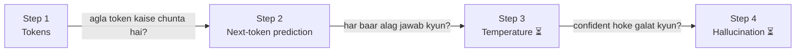
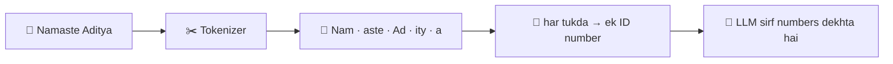
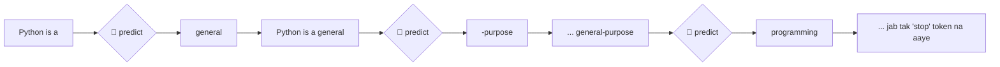

# 02 - How LLMs Work 🟡

🔗 **Pichle chapters se connection:** Chapter 01 mein LLM use kiya, aur streaming mein ajeeb tukde dekhe ("Nam" + "aste"). Chapter 08 mein LLM ne maths mein galti ki. Is chapter mein dekhenge ki **LLM ke andar asal mein kya hota hai**, aur ye sab kyun hua.



---

## Step 1: Tokens → [step1_tokens.py](step1_tokens.py)

### 🧠 Concept: token kya hai?
LLM **words nahi padhta**, woh **tokens** padhta hai. Token = text ka chhota tukda: poora word, aadha word, ek space ke saath word, ya sirf `,`.

**Tokenizer** = woh program jo text ko tokens mein todta hai. Har token ka ek **number (ID)** hota hai, aur LLM asal mein sirf in numbers ko dekhta hai.



> 💬 **Hinglish:** Tokens = **Lego blocks** 🧱. LLM ke paas lagbhag 1.28 lakh alag-alag blocks hain (Llama 3 ka vocabulary). Har sentence inhi blocks ko jod ke banta hai. Common words ("Python", " the") ek block hain. Rare words ("Aditya") 2-3 blocks mein toot jaate hain.

### 🔍 Part A: tokens dekhna
Streaming mein har chunk **ek token** hota hai (01 Step 6). Beech mein ` | ` lagake print kiya:
```
Python |  is |  a |  high | -level | , |  interpreted |  programming |  language | ...
```
Dhyan do:
- `" is"` mein **space bhi token ka hissa hai**
- `"high"` + `"-level"` = 2 tokens
- `,` aur `.` bhi alag tokens hain

### 🔢 Part B: tokens ginna
| Text | Tokens |
|---|---|
| `Hello, how are you?` (English) | **6** |
| `Namaste, aap kaise ho?` (Hinglish) | **9** |
| `नमस्ते, आप कैसे हैं?` (Hindi) | **12** 😮 |
| `48271 multiplied by 9183` | **7** |

**Isse 3 badi baatein samajh aati hain:**

**1. Hindi ko 2x tokens lagte hain.** Same baat, English mein 6 tokens, Hindi mein 12. Tokenizer zyada English text pe bana hai, isliye Hindi ke "blocks" chhote hain.
→ Hindi mein AI use karna **mehenga** padta hai aur **context window jaldi bharta hai** (01 Step 4).

**2. Numbers bhi tukdon mein toot-te hain.** Llama ka tokenizer numbers ko max 3 digit ke tukdon mein todta hai: `48271` → `482` + `71`. LLM ko poora number dikhta hi nahi, sirf tukde dikhte hain.
→ Isliye Chapter 08 mein LLM ka multiplication **galat** tha, aur calculator tool zaroori tha.

**3. Hidden tokens (25): har request mein kuch extra jaata hai.** Ollama humare messages ko ek **template** mein lapet ke bhejta hai (`ollama show llama3.2:3b --template` se dekh sakte ho):
```
<|start_header_id|>system<|end_header_id|>
Cutting Knowledge Date: December 2023
<|eot_id|><|start_header_id|>user<|end_header_id|>
Hello, how are you?<|eot_id|>
```
- `system` / `user` / `assistant` roles (01) asal mein aise **special tokens** ban jaate hain
- **`Cutting Knowledge Date: December 2023`**: model ka training data yahin tak ka hai. Isse aage ki duniya ke baare mein use kuch nahi pata. (Isliye current time ke liye tool chahiye tha, 08.)
- Jab tools dete hain, to template model ko bolta hai *"please respond with a JSON for a function call"*. **Isi wajah se** Chapter 08 mein model har sawal pe tool call kar raha tha!

> 💬 **Hinglish:** Tum jo message bhejte ho, woh ek envelope mein jaata hai. Envelope pe kuch extra likha hota hai (roles, date). Woh bhi tokens leta hai, bhale tumhe dikhe nahi.

### 📏 Yaad rakhne ka rule
**1 token ≈ ¾ English word** → 100 tokens ≈ 75 words. Hindi mein isse kaafi zyada tokens lagte hain.

### 📝 Code
```python
response.usage.prompt_tokens     # server batata hai: tumhare message ne kitne tokens liye
max_tokens=1                     # jawab sirf 1 token ka (humein sirf count chahiye)
count_tokens(text) - hidden      # hidden template tokens hata ke asli count
```
`count_tokens()` ek **function** hai (Chapter 00), jise har text ke liye baar-baar use kiya.

### 🌍 Real world
- **API ka bill tokens pe banta hai**: OpenAI, Claude, Gemini sab "per million tokens" ke hisaab se charge karte hain (input aur output alag rate)
- **Context window bhi tokens mein naapa jaata hai**: "128K context" = ek request mein ~1.28 lakh tokens
- **Indian languages ki problem**: isi token issue ki wajah se Indian companies (jaise Sarvam AI) Indic languages ke liye behtar tokenizers wale models bana rahi hain, taaki Hindi sasti aur fast ho

### 🧪 Khud try karo
```bash
python 02_how_llms_work/step1_tokens.py
```
- `texts` list mein apna naam, ek lamba word ("internationalization"), ya emoji 😀 daal ke tokens gino
- Part A ka prompt badal ke dekho, ki kaun se words tootte hain

**Problem 🤔** Theek hai, LLM tokens padhta hai. Par woh **agla token kaise chunta hai?** Kya woh "sochta" hai? → Step 2

---

## Step 2: Next-token prediction → [step2_next_token.py](step2_next_token.py)
🔗 **Step 1 se aage:** LLM tokens padhta hai. Ab dekhte hain ki woh **agla token kaise chunta hai**.

### 🧠 Concept: LLM sirf ek kaam karta hai
**"Ab tak ke tokens dekh ke, agla token kya hoga?"** Bas yahi. Har possible token (1.28 lakh blocks) ke liye woh ek **probability (chance %)** nikaalta hai, phir ek token chun leta hai.

Poora jawab isi ek kaam ko **baar-baar** karke banta hai. Har chuna hua token input mein jud jaata hai, aur phir agla token predict hota hai:

> 💬 **Hinglish:** LLM ek bahut tez **autocomplete** hai. Woh poora jawab pehle se "soch" ke nahi likhta. Ek-ek token likhta hai, aur har token ke baad sochta hai ki "ab aage kya aayega?". Isliye streaming (01 Step 6) mein jawab tukdon mein aata hai.

### 🔍 Part A: ek token ke options
`"The capital of France is"` ke baad:
```
'Paris'       99.91%  ███████████████████
'Par'          0.06%
' Paris'       0.01%
'PAR'          0.00%
'France'       0.00%
```
Model **99.91% sure** hai. Jab fact training data mein bahut baar aaya ho, to probability ek token pe concentrate ho jaati hai.

### 🔍 Part B: poora jawab = bahut saare choices
`"Python is a"` ke baad, har step pe top 3 options:
```
chosen 'general'        | options: 'high' 51%, 'programming' 14%, 'general' 10%
chosen '-purpose'       | options: '-purpose' 99%, ' purpose' 1%, ...
chosen ' programming'   | options: ' programming' 97%, ' language' 2%, ...
chosen ' language'      | options: ' language' 100%, ...
chosen '.'              | options: '.' 98%, ...
```
😮 **Pehle step pe model ne `'general'` (sirf 10%) chuna, jabki `'high'` 51% tha!**
- Model hamesha top wala token nahi chunta. Woh probability ke hisaab se **random draw** karta hai: 51% wala zyada baar aayega, par 10% wala bhi kabhi-kabhi aa jaata hai.
- Ek baar `'general'` chun liya, to aage ke tokens 97-100% sure ho gaye (`-purpose` → `programming` → `language`). Shuru ka ek choice poore jawab ki direction badal deta hai.
- Isi wajah se **same sawal pe har baar alag jawab** aata hai. Ye control kaise karte hain → Step 3 (Temperature)

### 🏋️ Ye probabilities aati kahan se hain? Training
| | **Training** (seekhna) | **Inference** (use karna) |
|---|---|---|
| Kya hota hai | Model internet ka text padhta hai aur har jagah "agla token" guess karta hai. Galat hua to khud ko thoda sudhaarta hai. Ye arabon baar hota hai. | Seekhe hue model se jawab nikalna. **Hum yahi kar rahe hain** |
| Kitna data | Llama 3: ~15 trillion tokens | Bas tumhara prompt |
| Kharcha | Hazaaron GPUs, mahine, crores ₹ | Tumhara laptop, seconds |
| Kab | Ek baar (Meta ne kiya) | Har request pe |

**Parameters** = model ke andar ke numbers ("knobs" 🎛️), jo training mein set hote hain. Inhi mein model ki saari "knowledge" hai.
- `llama3.2:3b` = **3 billion** knobs (~2 GB)
- Bade models: 70b, 400b+. Zyada parameters = zyada patterns yaad = usually smart, par zyada RAM aur slow

> 💬 **Hinglish:** Training = 12 saal school jaana (mehenga, lamba, ek baar). Inference = exam mein jawab likhna (fast, baar-baar). Parameters = dimaag mein jo yaad hai.

### 👀 Attention: LLM context kaise samajhta hai (simple idea)
Agla token predict karte waqt model **pichle saare tokens ko dekhta hai**, aur decide karta hai ki kaun se tokens **zyada important** hain.

*"Aditya ne Rahul ko phone kiya kyunki **woh** bore ho raha tha"*. Yahan "woh" predict/samajhne ke liye model "Aditya" pe zyada **dhyan (attention)** deta hai.

Is technique ko **Attention** kehte hain, aur jo model ise use karte hain unhe **Transformer** kehte hain. GPT ka "T" = Transformer. (2017 ka paper *"Attention Is All You Need"*.)

### 📝 Code
```python
logprobs=True,      # server, probabilities bhi bhejo
top_logprobs=5,     # top 5 options dikhao

math.exp(logprob) * 100    # logprob → percent
```
- **logprob** = probability ka "log" roop (computer ke liye convenient). `math.exp()` use normal chance bana deta hai. Bas itna yaad rakho: `logprob` 0 ke jitna paas, utna sure (`-0.001` ≈ 99.9%).
- `f"{percent:6.2f}%"` = **f-string**: number ko 2 decimal tak format karke text mein daalna.

### 🌍 Real world
- **Phone keyboard ke next-word suggestions**: same idea, bahut chhota model
- **Gmail Smart Compose, GitHub Copilot**: gray text mein aage ka suggestion = next-token prediction
- **Confidence check**: kuch companies logprobs dekh ke pata lagati hain ki model kitna sure hai. Kam probability = "ye jawab double-check karo"

### 🧪 Khud try karo
```bash
python 02_how_llms_work/step2_next_token.py
```
- 2-3 baar chalao: Part A har baar same (99.91% Paris), par Part B mein chosen tokens badal sakte hain
- Part A ka prompt badlo: `"My favourite colour is"`. Ab probabilities kaafi bikhri hongi (koi ek sahi jawab nahi hai)

**Problem 🤔** Model kabhi top token chunta hai, kabhi 10% wala. Ye **randomness kaun control karta hai?** Kya hum use kam-zyada kar sakte hain? → Step 3

## Step 3: Temperature ⏳
Same sawal pe har baar alag jawab kyun? Creative vs fixed jawab.

## Step 4: Hallucination ⏳
LLM confident hoke galat kyun bolta hai, aur isse kaise bachein.

### 🌍 Real world (preview)
- 2023 mein US ke kuch lawyers ne ChatGPT ke banaye **fake court cases** court mein submit kar diye (hallucination!)
