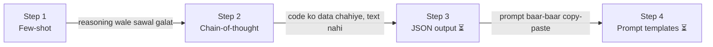
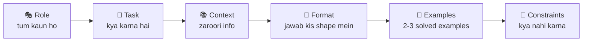
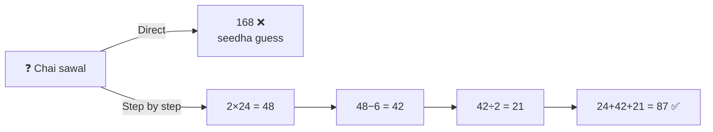

# 03 - Prompt Engineering 🟡

🔗 **Pichle chapters se connection:** Chapter 02 mein samjha ki LLM bas **agla token predict** karta hai, aur jo context window mein hai usi ke hisaab se karta hai. To jawab achha chahiye, to **context achha do**. Achha prompt likhne ki is skill ko **Prompt Engineering** kehte hain.



---

## Step 1: Few-shot → [step1_few_shot.py](step1_few_shot.py)

### 🧠 Concept: achhe prompt ke hisse

Har prompt mein sab zaroori nahi hai. Par jitna **clear** prompt, utna **predictable** jawab.

**Zero-shot vs Few-shot**
| | Zero-shot | Few-shot |
|---|---|---|
| Kya dete ho | Sirf instructions | Instructions + **2-5 solved examples** |
| Kab | Simple, common kaam | Specific format, tricky cases, apne rules |

> 💬 **Hinglish:** Naye intern ko kaam samjhana. Zero-shot = "reviews ko label kar do". Few-shot = "reviews ko label kar do, **ye dekho 3 kiye hue examples**". Doosre tareeke mein galti kam hogi.

### 🔍 Demo: food reviews ko label karna (temperature 0)
**Way 1: vague prompt** (*"What is the sentiment of this review: ..."*)
```
📝 Delivery time pe aayi, taste average tha
   → The sentiment of this review is neutral to slightly negative. The reviewer mentions that
     the delivery time was poor ("pe aayi")...
```
❌ Lamba essay (code mein use nahi kar sakte), aur "time pe aayi" ko "poor" samajh liya.

**Way 2: clear instructions** (*"Reply with exactly one word: POSITIVE, NEGATIVE or NEUTRAL"*)
```
📝 Paneer ekdum fresh tha, maza aa gaya 😋 → POSITIVE
📝 Paise waste, kabhi order mat karna    → NEGATIVE
📝 Delivery time pe aayi, taste average tha → NEGATIVE   ❌
```
✅ Format sahi, par mixed review **galat** label hua.

**Way 3: few-shot** (same rules + 3 examples, jinme ek NEUTRAL example bhi hai)
```
📝 Paneer ekdum fresh tha, maza aa gaya 😋 → POSITIVE
📝 Paise waste, kabhi order mat karna    → NEGATIVE
📝 Delivery time pe aayi, taste average tha → NEUTRAL    ✅
```
✅ Format bhi sahi, label bhi sahi. Example (*"Theek tha, kuch khaas nahi" → NEUTRAL*) se model ne samjha ki **humare hisaab se** "average" = NEUTRAL hai.

### 📝 Code: examples kaise dete hain
Examples ko ek **nakli purani chat** ki tarah likhte hain: `user` poochta hai, `assistant` exact format mein jawab deta hai.
```python
examples = [
    {"role": "user", "content": "Khana bahut tasty tha, delivery bhi fast thi!"},
    {"role": "assistant", "content": "POSITIVE"},
    {"role": "user", "content": "Order 2 ghante late aaya aur khana thanda tha."},
    {"role": "assistant", "content": "NEGATIVE"},
    ...
]
messages = [{"role": "system", "content": rules}] + examples + [{"role": "user", "content": review}]
```
- Yaad hai Chapter 01 Step 4 ki **memory**? Model purani chat padh ke jawab deta tha. Few-shot mein hum **khud ki banayi** purani chat daalte hain, taaki model usi pattern ko follow kare (next-token prediction, Ch 02).
- `list + list + list` = teen lists ko jod ke ek list

### ✅ Achhe examples ke rules
- **Har category ka kam se kam 1 example** do (yahan NEUTRAL wala example hi game-changer tha)
- **Tricky cases** ke examples do (mixed reviews)
- 2-5 examples kaafi hain. Zyada = zyada tokens = mehenga aur slow (Ch 02)

### 🌍 Real world
- **Food delivery / e-commerce apps** lakhon reviews aur complaints ko auto-label karte hain (positive/negative, "late delivery", "wrong item")
- **Support tickets ki routing**: "billing" → accounts team, "bug" → tech team
- **Email spam / priority filters**
- Production mein few-shot examples **apne asli data** se chune jaate hain: jahan model galti karta tha, wahi cases examples bana do

### 🧪 Khud try karo
```bash
python 03_prompt_engineering/step1_few_shot.py
```
- `reviews` mein apne reviews daalo, jaise sarcasm: *"Wah, 3 ghante mein delivery, kya speed hai 👏"*
- Naya label `MIXED` add karo: rules mein likho, aur ek example do

**Problem 🤔** Few-shot se **format aur labels** sudhar gaye. Par jin sawalon mein **sochna** padta hai (maths, logic, jaise 9.11 vs 9.9 from Ch 02), wahan model abhi bhi galti karta hai. → Step 2 (Chain-of-thought)

---

## Step 2: Chain-of-thought → [step2_chain_of_thought.py](step2_chain_of_thought.py)
🔗 **Fixes Step 1:** few-shot se format sudhra, par sochne wale sawal galat the. Ab model ko **pehle sochne** ka mauka denge.

### 🧠 Concept: model "dimaag mein" nahi sochta, **likh ke** sochta hai
Chapter 02 yaad karo: model ek-ek token predict karta hai, aur **jo token likh diya wo agle token ka context ban jaata hai**. Model ke paas alag se koi "sochne ki jagah" nahi hai. Uski rough copy wahi text hai jo wo likhta hai.

- **Direct** bologe → model ko pehle hi token mein final answer dena padta hai → guess
- **"Let's think step by step"** bologe → model beech ke steps (48, 42, 21) likhta hai → har step agle step ko easy banata hai


Har arrow ka matlab hai ki likha hua step **context window mein jud gaya**, aur agla token usko dekh ke predict hua.

> 💬 **Hinglish:** Exam mein lamba sum mann mein karoge to galti hogi. Rough copy pe step by step likhoge to sahi aayega. Chain-of-thought (CoT) = model ko **rough copy** dena.

### 🔍 Demo (temperature 0)
| Sawal | Sahi | ⚡ Direct | 🧠 Step-by-step |
|---|---|---|---|
| Chai stall: kul kitne cups? | 87 | 168 ❌ (2 tokens) | **87** ✅ (167 tokens) |
| Bat + ball = Rs 110, ball kitne ki? | 5 | Rs 10 ❌ (4 tokens) | **5** ✅ (171 tokens) |
| Main 6 ka tha, behen aadhi. Ab main 70 | 67 | 40 ❌ (3 tokens) | **67** ✅ (200 tokens) |

Teeno direct mein galat aaye, aur step by step mein sahi. Bas ek line add ki thi.

### 📝 Code
```python
think = " Let's think step by step. At the end write 'Answer: <answer>'."
text, tokens = ask(question + think)

def final_answer(text):
    return text.split("Answer:")[-1].strip()   # sirf last "Answer: ..." wala hissa
```
- `'Answer: <answer>'` maangne se reasoning lambi hone ke baad bhi code ko **saaf final jawab** mil jaata hai
- `text.split("Answer:")` text ko "Answer:" pe todta hai, aur `[-1]` = aakhri tukda
- `response.usage.completion_tokens` = model ne kitne tokens **likhe** (Ch 02)

### ⚖️ Kab use karein
| ✅ CoT lagao | ❌ Zaroorat nahi |
|---|---|
| Maths, word problems, logic, multi-step decisions | Simple labels (Step 1), translation, chhote facts |

**Keemat:** 2-4 tokens ki jagah ~170-200 tokens, yaani **~50-80x zyada tokens**. Jawab zyada slow aur zyada mehenga (Ch 02).

### ⚠️ Limit: CoT jaadu nahi hai
```
🔢 9.11 vs 9.9 (sahi: 9.9) → 9.11 ❌
   Model ka step: "0.11 is greater than 0.9"   ← step hi galat
🐍 Python says: 9.9 ✅
```
Agar koi **ek step galat** ho gaya, to aage ke saare steps usi galti pe build hote hain. Exact maths ya counting ke liye **code/tools** hi sahi hain (Ch 02 Part D, Ch 08).

### 🌍 Real world
- **Reasoning models** (OpenAI o-series, DeepSeek-R1, Claude ka extended thinking) ko train hi aise kiya gaya hai ki wo jawab se pehle khud lambi chain-of-thought likhein. ChatGPT mein jo **"Thinking..."** dikhta hai, wahi yeh hai.
- In "thinking tokens" ka bhi **paisa lagta hai**. Isliye mushkil sawal pe reasoning model aur simple kaam pe sasta normal model use karte hain.
- Apps user ko aksar **sirf final jawab** dikhate hain aur reasoning chhupa dete hain, bilkul humare `final_answer()` jaisa.
- Ollama pe bhi `deepseek-r1` / `qwen3` jaise thinking models chal sakte hain. Wo jawab se pehle `<think>...</think>` likhte hain.

### 🧪 Khud try karo
```bash
python 03_prompt_engineering/step2_chain_of_thought.py
```
- Apna sawal daalo: *"Ek train 60 km/h pe 2.5 ghante chali, fir 40 km/h pe 1.5 ghante. Kul doori?"* (sahi: 210 km)
- `think` ko Hindi mein likho: *" Step by step socho."* Kya ab bhi kaam karta hai?
- Ek aur sawal try karo: *"How many r's in strawberry?"* (sahi: 3). Yeh bhi tokenization (Ch 02) ki wajah se fail hota hai.

**Problem 🤔** Final jawab nikaalne ke liye humne `split("Answer:")` lagaya. Ek value ke liye yeh chal gaya, par agar AI se **kai cheezein** chahiye (naam, skills, experience), to text todna mushkil aur fragile ho jaata hai. Code ko **structured data** chahiye. → Step 3 (JSON output)

## Step 3: JSON output ⏳
Jawab JSON mein lena, taaki code use kar sake (resume → `{name, skills, experience}`).

## Step 4: Prompt templates ⏳
Variables wale reusable prompts.
