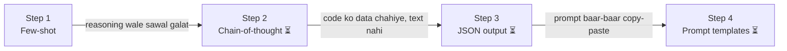
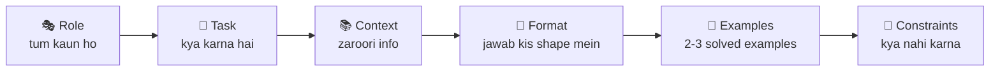

# 03 - Prompt Engineering 🟡

🔗 **Pichle chapters se connection:** Chapter 02 mein samjha ki LLM bas **agla token predict** karta hai, aur jo context window mein hai usi ke hisaab se karta hai. To jawab achha chahiye, to **context achha do**. Achha prompt likhne ki is skill ko **Prompt Engineering** kehte hain.



---

## Step 1: Few-shot → [step1_few_shot.py](step1_few_shot.py)

### 🧠 Concept: achhe prompt ke hisse

Har prompt mein sab zaroori nahi hai. Par jitna **clear** prompt, utna **predictable** jawab.

**Zero-shot vs Few-shot**
| | Zero-shot | Few-shot |
|---|---|---|
| Kya dete ho | Sirf instructions | Instructions + **2-5 solved examples** |
| Kab | Simple, common kaam | Specific format, tricky cases, apne rules |

> 💬 **Hinglish:** Naye intern ko kaam samjhana. Zero-shot = "reviews ko label kar do". Few-shot = "reviews ko label kar do, **ye dekho 3 kiye hue examples**". Doosre tareeke mein galti kam hogi.

### 🔍 Demo: food reviews ko label karna (temperature 0)
**Way 1: vague prompt** (*"What is the sentiment of this review: ..."*)
```
📝 Delivery time pe aayi, taste average tha
   → The sentiment of this review is neutral to slightly negative. The reviewer mentions that
     the delivery time was poor ("pe aayi")...
```
❌ Lamba essay (code mein use nahi kar sakte), aur "time pe aayi" ko "poor" samajh liya.

**Way 2: clear instructions** (*"Reply with exactly one word: POSITIVE, NEGATIVE or NEUTRAL"*)
```
📝 Paneer ekdum fresh tha, maza aa gaya 😋 → POSITIVE
📝 Paise waste, kabhi order mat karna    → NEGATIVE
📝 Delivery time pe aayi, taste average tha → NEGATIVE   ❌
```
✅ Format sahi, par mixed review **galat** label hua.

**Way 3: few-shot** (same rules + 3 examples, jinme ek NEUTRAL example bhi hai)
```
📝 Paneer ekdum fresh tha, maza aa gaya 😋 → POSITIVE
📝 Paise waste, kabhi order mat karna    → NEGATIVE
📝 Delivery time pe aayi, taste average tha → NEUTRAL    ✅
```
✅ Format bhi sahi, label bhi sahi. Example (*"Theek tha, kuch khaas nahi" → NEUTRAL*) se model ne samjha ki **humare hisaab se** "average" = NEUTRAL hai.

### 📝 Code: examples kaise dete hain
Examples ko ek **nakli purani chat** ki tarah likhte hain: `user` poochta hai, `assistant` exact format mein jawab deta hai.
```python
examples = [
    {"role": "user", "content": "Khana bahut tasty tha, delivery bhi fast thi!"},
    {"role": "assistant", "content": "POSITIVE"},
    {"role": "user", "content": "Order 2 ghante late aaya aur khana thanda tha."},
    {"role": "assistant", "content": "NEGATIVE"},
    ...
]
messages = [{"role": "system", "content": rules}] + examples + [{"role": "user", "content": review}]
```
- Yaad hai Chapter 01 Step 4 ki **memory**? Model purani chat padh ke jawab deta tha. Few-shot mein hum **khud ki banayi** purani chat daalte hain, taaki model usi pattern ko follow kare (next-token prediction, Ch 02).
- `list + list + list` = teen lists ko jod ke ek list

### ✅ Achhe examples ke rules
- **Har category ka kam se kam 1 example** do (yahan NEUTRAL wala example hi game-changer tha)
- **Tricky cases** ke examples do (mixed reviews)
- 2-5 examples kaafi hain. Zyada = zyada tokens = mehenga aur slow (Ch 02)

### 🌍 Real world
- **Food delivery / e-commerce apps** lakhon reviews aur complaints ko auto-label karte hain (positive/negative, "late delivery", "wrong item")
- **Support tickets ki routing**: "billing" → accounts team, "bug" → tech team
- **Email spam / priority filters**
- Production mein few-shot examples **apne asli data** se chune jaate hain: jahan model galti karta tha, wahi cases examples bana do

### 🧪 Khud try karo
```bash
python 03_prompt_engineering/step1_few_shot.py
```
- `reviews` mein apne reviews daalo, jaise sarcasm: *"Wah, 3 ghante mein delivery, kya speed hai 👏"*
- Naya label `MIXED` add karo: rules mein likho, aur ek example do

**Problem 🤔** Few-shot se **format aur labels** sudhar gaye. Par jin sawalon mein **sochna** padta hai (maths, logic, jaise 9.11 vs 9.9 from Ch 02), wahan model abhi bhi galti karta hai. → Step 2 (Chain-of-thought)

---

## Step 2: Chain-of-thought ⏳
"Step by step socho" se reasoning wale sawal kaise sudharte hain.

## Step 3: JSON output ⏳
Jawab JSON mein lena, taaki code use kar sake (resume → `{name, skills, experience}`).

## Step 4: Prompt templates ⏳
Variables wale reusable prompts.
