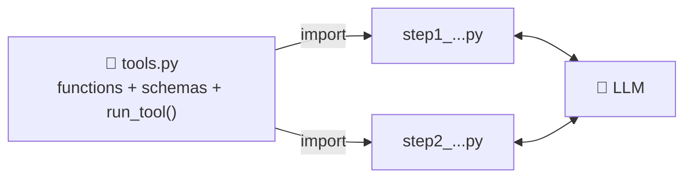
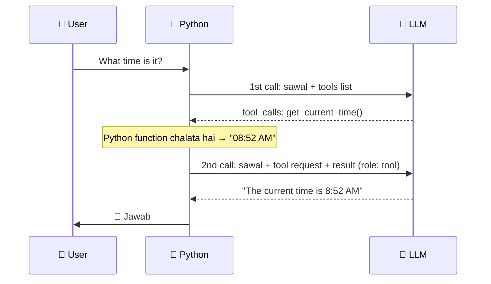
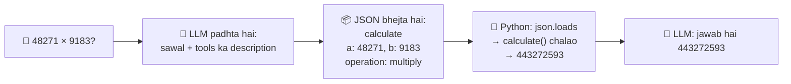

# 08 - Tool Calling ✅

🔗 **Chapter 01 se connection:** Ab tak AI sirf **bolta** tha. Usse poocho "abhi time kya hai?", to woh nahi bata pata, ya galat bata deta hai. Is chapter mein AI **kaam bhi karega**: functions (tools) call karke.

> ℹ️ Ye chapter humne roadmap se pehle padha (01 ke baad seedha 08), kyunki ise sirf Chapter 01 ki zaroorat hai. Phase 3 yahin se shuru hota hai.

## Kya seekhenge
- **Tool / function calling**: AI decide karta hai ki kaunsa function, kis input ke saath chalana hai
- **Tool schema**: function ka description JSON mein
- Function ka result wapas LLM ko dena (`role: "tool"`)
- Inputs wale tools (calculator) + multiple tools

## 📁 Is chapter ki files
| File | Kya hai |
|---|---|
| [tools.py](tools.py) | **Saare tools yahan hain.** Har tool = Python function + uska schema. Saath mein `run_tool()` jo naam se sahi function chalata hai |
| [step1_current_time_tool.py](step1_current_time_tool.py) | Tool calling ka **flow** (1 tool) |
| [step2_tools_with_inputs.py](step2_tools_with_inputs.py) | Tool calling ka **flow** (2 tools, inputs ke saath) |


> 💬 **Hinglish:** `tools.py` = toolbox 🧰 (saare auzaar ek jagah). Step files = kaarigar ka kaam (auzaar kab aur kaise use karne hain). Naya tool chahiye to sirf `tools.py` mein add karo, step files ko chhedna nahi padega.

Python mein dusri file se cheezein lene ke liye:
```python
from tools import get_current_time, time_tool_schema
```
Ye wahi `import` hai jo Chapter 00 mein padha tha, bas ab apni khud ki file se.

---

## Step 1: Current time tool → [step1_current_time_tool.py](step1_current_time_tool.py)

### 🤔 LLM time kyun nahi bata pata?
1. **LLM ke paas ghadi nahi hai.** Woh sirf text predict karta hai, laptop ki clock nahi dekh sakta.
2. **Stateless + context window** (01): LLM sirf wahi jaanta hai jo context window mein hai, aur wahan time likha hi nahi hai.
3. **Training data purana hai.** Isliye woh confident hoke galat date bata sakta hai (hallucination, Chapter 02).

### 🧠 Concept: tool calling
**LLM khud function nahi chalata.** Woh sirf bolta hai "ye function chalao". Function **hamara Python code** chalata hai aur result LLM ko wapas deta hai.

> 💬 **Hinglish:** LLM = boss jo bolta hai "time pata karo". Python = assistant jo ghadi dekh ke batata hai. Boss phir customer ko poora jawab deta hai.


**Ek sawal = 2 LLM calls.** Pehli call mein LLM decide karta hai, doosri mein jawab likhta hai.

### 📝 Code
Tool ka function aur schema [tools.py](tools.py) mein hain. Step file unhe `import` karti hai:
```python
from tools import get_current_time, time_tool_schema
tools = [time_tool_schema]                 # LLM ko kaun se tools milenge
```

**1. Asli Python function (tool)**, [tools.py](tools.py) mein:
```python
def get_current_time():
    return datetime.now().strftime("%I:%M %p, %d %B %Y")
```

**2. Tool ka description (schema)**, [tools.py](tools.py) mein. LLM tumhara code nahi padhta, sirf ye description padhta hai:
```python
time_tool_schema = {
    "type": "function",
    "function": {
        "name": "get_current_time",                       # function ka naam
        "description": "Get the current local time ...",  # kab use karna hai (LLM yahi padh ke decide karta hai)
        "parameters": {"type": "object", "properties": {}},  # inputs (abhi koi nahi)
    },
}
```

**3. First call: `tools=tools` bhejo**
```python
response = client.chat.completions.create(model=model, messages=messages, tools=tools)
ai_message = response.choices[0].message
```

**4. Check karo: LLM ne tool maanga?**
```python
if ai_message.tool_calls:                  # haan, tool chahiye
    tool_call = ai_message.tool_calls[0]
    result = get_current_time()            # HUM function chalate hain
```

**5. Result memory mein daalo + second call**
```python
messages.append(ai_message)                                    # LLM ki request
messages.append({"role": "tool", "tool_call_id": tool_call.id, "content": result})  # tool ka result
final = client.chat.completions.create(model=model, messages=messages, tools=tools)
```

Naya role: **`tool`** = "ye function ka result hai". `tool_call_id` batata hai ki ye kis request ka jawab hai.

| role | kaun |
|---|---|
| `system` | rules (01 Step 5) |
| `user` | tum |
| `assistant` | AI (yahan tool maangna bhi isi mein aata hai) |
| `tool` | function ka result 🆕 |

### ⚠️ Test mein mili asli problem
| Sawal | Tool chala? | Sahi tha? |
|---|---|---|
| What time is it? | ✅ haan | ✅ |
| Aaj kaunsa din hai? | ✅ haan | ✅ |
| Capital of France? | ✅ haan | ❌ zaroorat nahi thi |
| Tell me a joke | ✅ haan | ❌ zaroorat nahi thi |

`llama3.2:3b` ko tools diye jaayein to woh **har sawal pe** tool call kar deta hai. Clear description aur system prompt dono try kiye, phir bhi fark nahi pada. Final jawab phir bhi sahi aaya, kyunki model bekaar result ignore kar deta hai. Par extra time aur extra call lagti hai.

**Lesson:** "Kaunsa tool kab chalana hai" ye decide karna mushkil kaam hai. **Bade models** (`qwen2.5:7b`, `llama3.1:8b`, GPT, Claude) ye bahut better karte hain. Real projects mein tool-calling ke liye model soch-samajh ke chuno.

### 🌍 Real world
- **ChatGPT** ka web search, code chalana, image banana: sab tools hain
- **Alexa / Siri**: "alarm laga do" → `set_alarm(time="7:00")` jaisa tool call
- **Travel / food apps ke bots**: asli flights search, order status check
- **Claude Code / Cursor**: file padhna, code likhna, commands chalana, sab tool calls hain (Chapter 09 mein aur detail)

### 🧪 Khud try karo
```bash
python 08_tool_calling/step1_current_time_tool.py
```
"What time is it?" aur "Tell me a joke" dono poocho, aur 🧠 / 🐍 wali lines dekho.

**Problem 🤔** Hamara tool koi **input** nahi leta. Asli tools ko inputs chahiye, jaise `calculator(a=25, b=4)` ya `get_weather(city="Delhi")`. → Step 2

---

## Step 2: Tools with inputs → [step2_tools_with_inputs.py](step2_tools_with_inputs.py)
🔗 **Step 1 ki problem fix:** ab tool **inputs** leta hai, aur LLM khud decide karta hai ki inputs kya bharne hain. Saath mein **2 tools** hain, aur LLM khud chunta hai ki kaunsa chahiye.

### 🤔 Calculator tool kyun? LLM to "smart" hai na?
LLM **calculate nahi karta**, woh sirf **agla token guess karta hai**. Isliye bade numbers mein galti karta hai. Humara test:

| Kaun | `48271 × 9183` = ? |
|---|---|
| LLM akela (try 1) | 4401354139 ❌ |
| LLM akela (try 2) | 442,071,903 ❌ |
| LLM akela (try 3) | 439,893,123 ❌ |
| **LLM + calculator tool** | **443272593** ✅ |

Teeno baar galat, aur har baar **alag** galat jawab.

> 💬 **Hinglish:** LLM ek bahut padha-likha insaan hai jo maths "andaaze" se bolta hai. Calculator tool use dene se woh andaaza nahi lagata, calculator se poochta hai.

### 🧠 Concept: LLM inputs kaise bharta hai?

LLM tumhare sawal mein se numbers **nikaal ke** sahi jagah bhar deta hai. Ye sab woh tool ke **description** padh ke karta hai.

### 📝 Code: Step 1 se kya naya hai
Step file mein ab **2 tools** jaate hain:
```python
from tools import time_tool_schema, calculator_tool_schema, run_tool
tools = [time_tool_schema, calculator_tool_schema]
```

**1. Function jo inputs leta hai**, [tools.py](tools.py) mein:
```python
def calculate(a, b, operation):
    a = float(a)          # text ya number, dono ko decimal number banao
    ...
    if operation == "multiply":
        return str(a * b)
```

**2. Schema mein har input ka description**, `calculator_tool_schema` ([tools.py](tools.py)) mein:
```python
"parameters": {
    "type": "object",
    "properties": {
        "a": {"type": "number", "description": "First number"},
        "b": {"type": "number", "description": "Second number"},
        "operation": {"type": "string", "enum": ["add", "subtract", "multiply", "divide"]},
    },
    "required": ["a", "b", "operation"],
}
```
| Cheez | Matlab |
|---|---|
| `properties` | kaun-kaun se inputs hain |
| `type` | input kis tarah ka hai: `number`, `string` |
| `enum` | sirf yahi values allowed hain (LLM "multiplication" ya "times" nahi likh sakta) |
| `required` | ye inputs dena zaroori hai |

**3. LLM ke inputs padhna (`json.loads`):**
```python
args = json.loads(tool_call.function.arguments)
# '{"a": 48271, "b": 9183, "operation": "multiply"}'  (text)
#   → {"a": 48271, "b": 9183, "operation": "multiply"}  (dictionary)
```
LLM inputs **text** (JSON string) mein bhejta hai. `json.loads` usse Python **dictionary** bana deta hai (Chapter 00), phir `args["a"]` se value nikaal lete hain.

**4. Sahi function chunna:** LLM sirf tool ka **naam** aur inputs deta hai. `run_tool()` ([tools.py](tools.py)) naam dekh ke sahi function chalata hai:
```python
# step file mein:
result = run_tool(name, args)

# tools.py mein:
def run_tool(name, args):
    if name == "get_current_time":
        return get_current_time()
    if name == "calculate":
        return calculate(args["a"], args["b"], args["operation"])
    return "Unknown tool"
```

**5. `for` loop over `tool_calls`:** LLM ek saath **ek se zyada tools** maang sakta hai (jaise "time batao aur 5+5 bhi"), isliye sab pe loop chalate hain.

### Test result ✅
```
You: What is 48271 multiplied by 9183?
🧠 LLM says: run calculate with inputs {'operation': 'multiply', 'a': 48271, 'b': 9183}
🐍 Python ran it. Result: 443272593.0
🤖 AI: The result of multiplying 48271 by 9183 is 443272593.0.

You: What time is it?
🧠 LLM says: run get_current_time with inputs {}
```
LLM ne har baar **sahi tool** chuna aur **sahi inputs** bhare.

### 🌍 Real world
- **ChatGPT** maths ke liye andar se Python code chalata hai, jo isi idea ka bada version hai
- **Weather apps ke bots**: `get_weather(city="Delhi")`, jahan city tumhare sawal se nikaali jaati hai
- **Food / shopping bots**: `track_order(order_id="A123")`
- **Google Calendar assistants**: `create_event(title="Meeting", time="3 PM")`

### 🧪 Khud try karo
```bash
python 08_tool_calling/step2_tools_with_inputs.py
```
- "What is 999 times 777?"
- "Abhi time kya hai?"
- **Challenge:** ek naya tool `get_weather(city)` add karo jo bas `"Sunny, 25°C in " + city` return kare. Sirf [tools.py](tools.py) mein 3 cheezein add karni hain: function, `weather_tool_schema`, aur `run_tool()` mein ek `if`. Phir step2 ki `tools` list mein `weather_tool_schema` jod do.

---

## ✅ Chapter 08 summary
| Concept | Ek line mein |
|---|---|
| Tool calling | LLM bolta hai "ye function chalao", Python chalata hai |
| Tool schema | function ka description (naam, kaam, inputs). LLM yahi padhta hai |
| 2 calls | 1st: LLM tool maangta hai → 2nd: result padh ke jawab |
| `role: "tool"` | function ka result LLM ko wapas dena |
| `json.loads` | LLM ke text inputs → Python dictionary |
| Kyun zaroori | LLM ke paas ghadi nahi hai, maths andaaze se karta hai, internet/DB nahi dekh sakta |

**Limitation 🤔** Abhi sirf **ek round** hai: tool → jawab → khatam. Agar kaam mein kai steps lagein ("time dekho, phir usme 2 ghante jodo, phir batao"), to LLM ko **baar-baar** tools chalane chahiye jab tak kaam pura na ho. Yahi **Agent** hai → [Chapter 09](../09_ai_agents_and_harness/).

➡️ **Ab wapas roadmap pe:** [Chapter 02 - How LLMs Work](../02_how_llms_work/). Isi chapter mein dekhoge ki LLM maths mein galti kyun karta hai (tokens + next-token prediction).
