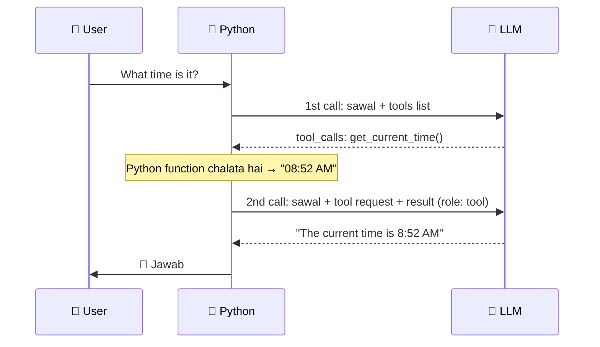

# 08 - Tool Calling 🟡

🔗 **Chapter 01 se connection:** Ab tak AI sirf **bolta** tha. Usse poocho "abhi time kya hai?", to woh nahi bata pata, ya galat bata deta hai. Is chapter mein AI **kaam bhi karega**: functions (tools) call karke.

> ℹ️ Ye chapter humne roadmap se pehle padha (01 ke baad seedha 08), kyunki ise sirf Chapter 01 ki zaroorat hai. Phase 3 yahin se shuru hota hai.

## Kya seekhenge
- **Tool / function calling**: AI decide karta hai ki kaunsa function, kis input ke saath chalana hai
- **Tool schema**: function ka description JSON mein
- Function ka result wapas LLM ko dena (`role: "tool"`)
- Inputs wale tools (calculator, weather) ⏳

---

## Step 1: Current time tool → [step1_current_time_tool.py](step1_current_time_tool.py)

### 🤔 LLM time kyun nahi bata pata?
1. **LLM ke paas ghadi nahi hai.** Woh sirf text predict karta hai, laptop ki clock nahi dekh sakta.
2. **Stateless + context window** (01): LLM sirf wahi jaanta hai jo context window mein hai, aur wahan time likha hi nahi hai.
3. **Training data purana hai.** Isliye woh confident hoke galat date bata sakta hai (hallucination, Chapter 02).

### 🧠 Concept: tool calling
**LLM khud function nahi chalata.** Woh sirf bolta hai "ye function chalao". Function **hamara Python code** chalata hai aur result LLM ko wapas deta hai.

> 💬 **Hinglish:** LLM = boss jo bolta hai "time pata karo". Python = assistant jo ghadi dekh ke batata hai. Boss phir customer ko poora jawab deta hai.


**Ek sawal = 2 LLM calls.** Pehli call mein LLM decide karta hai, doosri mein jawab likhta hai.

### 📝 Code
**1. Asli Python function (tool):**
```python
def get_current_time():
    return datetime.now().strftime("%I:%M %p, %d %B %Y")
```

**2. Tool ka description (schema):** LLM tumhara code nahi padhta, sirf ye description padhta hai
```python
tools = [{
    "type": "function",
    "function": {
        "name": "get_current_time",                       # function ka naam
        "description": "Get the current local time ...",  # kab use karna hai (LLM yahi padh ke decide karta hai)
        "parameters": {"type": "object", "properties": {}},  # inputs (abhi koi nahi)
    },
}]
```

**3. First call: `tools=tools` bhejo**
```python
response = client.chat.completions.create(model=model, messages=messages, tools=tools)
ai_message = response.choices[0].message
```

**4. Check karo: LLM ne tool maanga?**
```python
if ai_message.tool_calls:                  # haan, tool chahiye
    tool_call = ai_message.tool_calls[0]
    result = get_current_time()            # HUM function chalate hain
```

**5. Result memory mein daalo + second call**
```python
messages.append(ai_message)                                    # LLM ki request
messages.append({"role": "tool", "tool_call_id": tool_call.id, "content": result})  # tool ka result
final = client.chat.completions.create(model=model, messages=messages, tools=tools)
```

Naya role: **`tool`** = "ye function ka result hai". `tool_call_id` batata hai ki ye kis request ka jawab hai.

| role | kaun |
|---|---|
| `system` | rules (01 Step 5) |
| `user` | tum |
| `assistant` | AI (yahan tool maangna bhi isi mein aata hai) |
| `tool` | function ka result 🆕 |

### ⚠️ Test mein mili asli problem
| Sawal | Tool chala? | Sahi tha? |
|---|---|---|
| What time is it? | ✅ haan | ✅ |
| Aaj kaunsa din hai? | ✅ haan | ✅ |
| Capital of France? | ✅ haan | ❌ zaroorat nahi thi |
| Tell me a joke | ✅ haan | ❌ zaroorat nahi thi |

`llama3.2:3b` ko tools diye jaayein to woh **har sawal pe** tool call kar deta hai. Clear description aur system prompt dono try kiye, phir bhi fark nahi pada. Final jawab phir bhi sahi aaya, kyunki model bekaar result ignore kar deta hai. Par extra time aur extra call lagti hai.

**Lesson:** "Kaunsa tool kab chalana hai" ye decide karna mushkil kaam hai. **Bade models** (`qwen2.5:7b`, `llama3.1:8b`, GPT, Claude) ye bahut better karte hain. Real projects mein tool-calling ke liye model soch-samajh ke chuno.

### 🌍 Real world
- **ChatGPT** ka web search, code chalana, image banana: sab tools hain
- **Alexa / Siri**: "alarm laga do" → `set_alarm(time="7:00")` jaisa tool call
- **Travel / food apps ke bots**: asli flights search, order status check
- **Claude Code / Cursor**: file padhna, code likhna, commands chalana, sab tool calls hain (Chapter 09 mein aur detail)

### 🧪 Khud try karo
```bash
python 08_tool_calling/step1_current_time_tool.py
```
"What time is it?" aur "Tell me a joke" dono poocho, aur 🧠 / 🐍 wali lines dekho.

**Problem 🤔** Hamara tool koi **input** nahi leta. Asli tools ko inputs chahiye, jaise `calculator(a=25, b=4)` ya `get_weather(city="Delhi")`. → Step 2

---

## Step 2: Tools with inputs ⏳
Calculator + multiple tools, LLM khud inputs bhare (JSON arguments).
