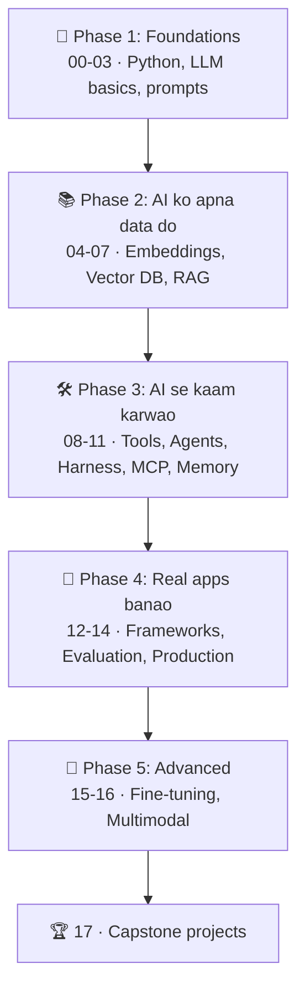

# Learning AI 🤖

Mera AI seekhne ka safar: zero se lekar **RAG, Vector DB, Agents, MCP, Fine-tuning** tak. Jahan ho sake, sab kuch laptop pe free model (Ollama) se.

**Rules**
- 1 folder = 1 concept. Har folder mein short notes (README) + chhote code files.
- Har chapter pichle chapter pe build karta hai. Order se padho.
- Har chapter mein **🌍 Real world** section hai: ye cheez aaj kahan use ho rahi hai.

## 🗺️ Roadmap



| # | Chapter | Kya seekhenge | Status |
|---|---|---|---|
| 00 | [Python Basics](00_python_basics/) | variables, list, dict, loops, functions | ✅ |
| 01 | [Chat with Local AI](01_chat_with_local_ai/) | LLM call, roles, context window, memory, system prompt, streaming | ✅ |
| 02 | [How LLMs Work](02_how_llms_work/) | tokens, next-token prediction, temperature, hallucination | 🟡 2/4 |
| 03 | [Prompt Engineering](03_prompt_engineering/) | few-shot, chain-of-thought, JSON output | ⏳ |
| 04 | [Embeddings](04_embeddings/) | text → numbers (vector), similarity, semantic search | ⏳ |
| 05 | [Vector Databases](05_vector_databases/) | Chroma, vectors store + search, metadata | ⏳ |
| 06 | [RAG Basics](06_rag_basics/) | apne documents se AI ko jawab dilwana | ⏳ |
| 07 | [Advanced RAG](07_advanced_rag/) | chunking, hybrid search, re-ranking, citations | ⏳ |
| 08 | [Tool Calling](08_tool_calling/) | AI khud functions call kare | ✅ |
| 09 | [AI Agents & Harness](09_ai_agents_and_harness/) | agent loop, ReAct, harness kya hota hai | ⏳ |
| 10 | [MCP](10_mcp/) | AI ko apps se jodne ka standard plug | ⏳ |
| 11 | [Memory & Storage](11_memory_and_storage/) | permanent memory, chat DB mein save | ⏳ |
| 12 | [Frameworks](12_frameworks/) | LangChain, LlamaIndex, LangGraph | ⏳ |
| 13 | [Evaluation & Observability](13_evaluation_and_observability/) | AI ka jawab sahi hai ya nahi kaise naapein, tracing | ⏳ |
| 14 | [Production & Safety](14_production_and_safety/) | API, UI, cost, prompt injection, guardrails | ⏳ |
| 15 | [Fine-tuning](15_fine_tuning/) | model ko apne data pe train karna (LoRA) | ⏳ |
| 16 | [Multimodal](16_multimodal/) | images, audio, vision models | ⏳ |
| 17 | [Capstone Projects](17_capstone_projects/) | sab jod ke real projects | ⏳ |

## 📖 Har chapter kaise padhein
1. README padho (concept → diagram → code → real world)
2. Code khud chalao, thoda badal ke dekho
3. Mini project karo
4. Commit + push 🚀

## Quick start
```bash
python3 -m venv .venv
source .venv/bin/activate
pip install -r requirements.txt
cp .env.example .env
open -a Ollama
python 01_chat_with_local_ai/step6_streaming.py
```
